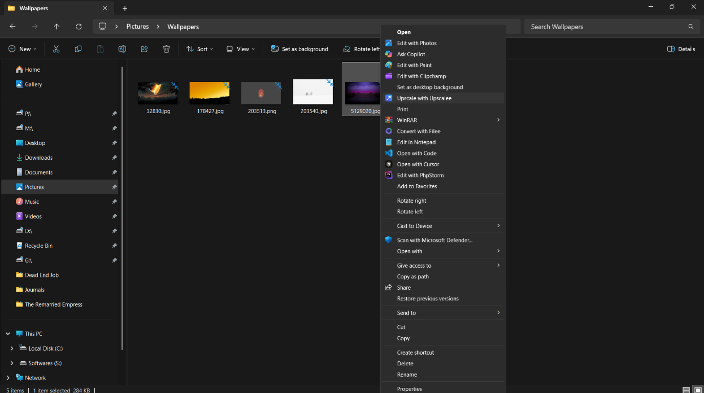
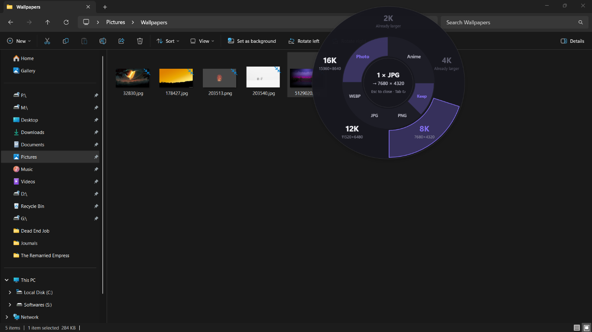

<p align="center">
  
</p>

<h1 align="center">Upscalee</h1>

<p align="center">
Right-click any image in Windows Explorer → <b>Upscale with Upscalee</b> → pick 2K, 4K, 8K, 12K or 16K
on a radial menu → an AI-upscaled copy is saved next to the original.<br>
Fully offline · GPU accelerated (Vulkan, any vendor) · no window, no extra clicks.
</p>

---

## Features

* **Explorer Right-Click Action** — classic context menu (Windows 10, Windows 11 "Show more options") and the Windows 11 modern menu via a signed sparse package.
* **Radial Upscale Picker** at the cursor: 2K / 4K / 8K / 12K / 16K (longest edge), Photo/Anime model, Keep/PNG/JPG/WEBP — mouse or keyboard (`2 4 8 1 6`, arrows, Enter, Tab, F, Esc).
* **Real-ESRGAN** (ncnn Vulkan) with tiled inference, automatic smaller tiles on VRAM errors, and an exact Lanczos3 final resize.
* **Multi-select** (`3 × PNG`), job queue with cancel, progress panel with **Open / Show in folder**, tray icon.
* **Safe outputs** — `photo_4K.png`, `photo_4K (1).png`…; never overwrites; atomic writes; EXIF orientation, transparency and ICC profiles preserved.
* **Graceful fallbacks** — no GPU → high-quality standard resize (clearly labelled), not enough RAM → "try 8K", unwritable folder → `Pictures\Upscalee`.

## How the Explorer workflow works

The two visible parts of the workflow have been named to match the user
experience shown in the screenshots:

1. **Explorer Right-Click Action** — select one or more supported images in
   Windows File Explorer, right-click, and choose **Upscale with Upscalee**.
   The action is available in the classic menu and, when the sparse package is
   installed and signed, in the Windows 11 modern context menu.
2. **Radial Upscale Picker** — Upscalee opens a compact menu around the cursor
   instead of a separate full application window. Choose the target size from
   the outer ring, then choose the model and output format from the inner ring.
   Disabled sizes are marked when an image is already larger than the selected
   target, and the same controls are available from the keyboard.

After a selection is confirmed, the job is queued and the upscaled copy is
saved beside the original without overwriting it.

### Explorer Right-Click Action



### Radial Upscale Picker



## Quick start (development)

Requirements: Windows 10 2004+/11 x64, Rust (MSVC) ≥ 1.85, VS 2022 Build Tools (C++ + Windows SDK), Node 20+, pnpm 10, PowerShell 7.

```powershell
pnpm install
pwsh scripts/fetch-engine.ps1                 # pinned Real-ESRGAN engine → engine/bin
cargo test --workspace                        # Rust tests
pnpm --filter upscalee-desktop test           # UI tests
cargo run -p upscalee-core --features cli --release -- photo.png --preset 4K   # try the pipeline
pwsh scripts/build-release.ps1                # → target/release/bundle/nsis/Upscalee_0.1.0_x64-setup.exe
```

## Repository layout

```
crates/upscalee-core     pipeline: presets, planner, imaging, engine runner, naming, settings
crates/upscalee-ipc      named-pipe protocol shared by the app and the shell extension
apps/desktop             Tauri 2 app (src-tauri) + React UI (radial menu, activity HUD, settings)
apps/shell-extension     UpscaleeShell.dll (IExplorerCommand) + Windows 11 sparse package manifest
engine/ installer/ scripts/ docs/
```

## Documentation

[docs/README.md](docs/README.md) indexes everything: [PRD](docs/PRD.md) ·
[Architecture](docs/ARCHITECTURE.md) · [Design system](docs/DESIGN_SYSTEM.md) ·
[Security](docs/SECURITY.md) · [Testing](docs/TESTING_STRATEGY.md) ·
[Deployment](docs/DEPLOYMENT.md) · [Roadmap](docs/ROADMAP.md) · [ADRs](docs/adr/).
Contributing: [CONTRIBUTING.md](CONTRIBUTING.md) · agents: [AGENTS.md](AGENTS.md).

## Quality notes

AI upscaling invents plausible detail; it cannot recover detail that was never
captured — a 500 px image at 16K looks clean but synthetic. 16K PNGs can be
100–300 MB; choose JPG or WEBP for those.

## License

No license has been chosen yet (see [PRD open question Q2](docs/PRD.md#11-open-questions)).
Third-party components: [THIRD_PARTY_NOTICES.md](THIRD_PARTY_NOTICES.md).

Maintained by [@ChamathDilshanC](https://github.com/ChamathDilshanC).
